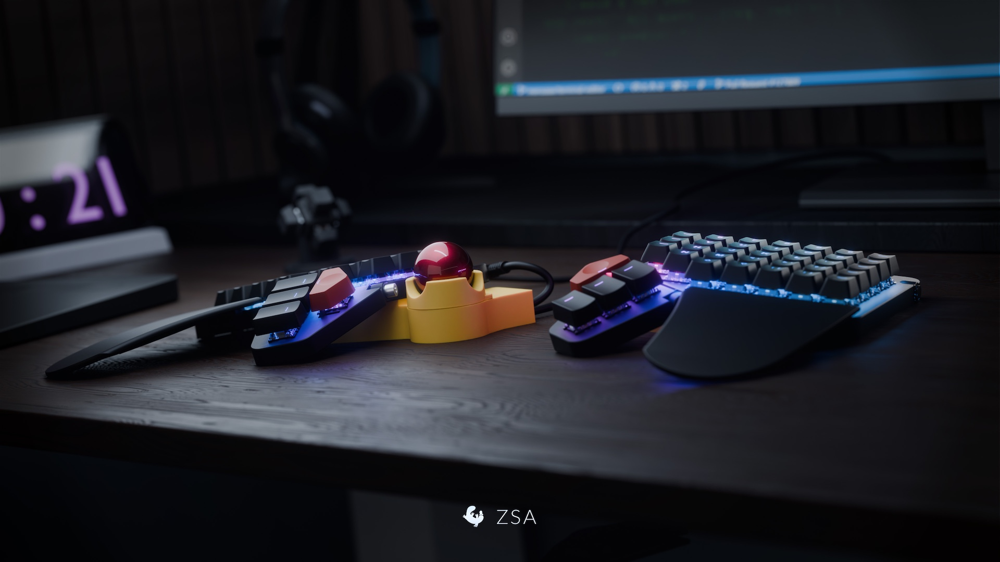

# Underglow

A colour scheme for command-line tools, built from a single palette.

Underglow is a dark scheme inspired by a photograph of a desk lit by RGB underglow: a violet
and periwinkle glow behind the keyboard, an electric blue wash along the keycaps, a teal terminal
on the screen, an amber trackball and a crimson one, all sitting on a near-black wooden desk.



_Photo by [ZSA](https://www.zsa.io/). The palette — the violet underglow, the blue wash along the
keycaps, the teal terminal, the amber and crimson trackballs and the near-black desk — is sampled
from this image._

Every tool in this repository renders from the same base colours plus six derived tints, so a file
listing, a diff, a syntax-highlighted source file and a status bar all read as one system.

| Tool | Scheme | Install path |
| --- | --- | --- |
| [bat](bat/) | TextMate `.tmTheme` | `~/.config/bat/themes/` |
| [eza](eza/) | `theme.yml` | `~/.config/eza/` |
| [fzf](fzf/) | `fzf.conf` | `~/.config/fzf/` |
| [ghostty](ghostty/) | `underglow` | `~/.config/ghostty/themes/` |
| [lazygit](lazygit/) | `config.yml` | `~/.config/lazygit/` |
| [tuicr](tuicr/) | theme TOML + `.tmTheme` | `~/.config/tuicr/themes/` |

Each tool has its own directory with the scheme file and a short README covering installation and
verification.

## Install everything

```sh
cd /path/to/underglow

mkdir -p ~/.config/bat/themes ~/.config/eza ~/.config/fzf ~/.config/ghostty/themes \
         ~/.config/lazygit ~/.config/tuicr/themes

cp "bat/Underglow.tmTheme" ~/.config/bat/themes/
cp eza/theme.yml            ~/.config/eza/theme.yml
cp fzf/fzf.conf             ~/.config/fzf/fzf.conf
cp ghostty/underglow        ~/.config/ghostty/themes/underglow
cp tuicr/underglow.toml     ~/.config/tuicr/themes/
cp tuicr/underglow-syntax.tmTheme ~/.config/tuicr/themes/
```

`lazygit` is the exception: its file only sets colours, so merge the `gui.theme` block into an
existing `~/.config/lazygit/config.yml` rather than replacing it.

Then pick it up:

- **bat** — add `--theme="Underglow"` to `~/.config/bat/config`, then `bat cache --build`
- **ghostty** — set `theme = underglow` in `~/.config/ghostty/config`, then reload the window (`Cmd+Shift+,`)
- **lazygit** — merge `lazygit/config.yml` into `~/.config/lazygit/config.yml`
- **tuicr** — set `theme = "underglow"` in `~/.config/tuicr/config.toml`
- **fzf** — export `FZF_DEFAULT_OPTS_FILE=~/.config/fzf/fzf.conf` from your shell rc
- **eza** — reads its config on next invocation

## Palette

### Terminal

| Role | Hex |
| --- | --- |
| Background | `#0B0D14` |
| Foreground | `#C6CADF` |
| Cursor | `#9D8CFF` |
| Cursor text | `#0B0D14` |
| Selection | `#2A2F47` |
| Selected text | `#E7EAF6` |

### ANSI

| Index | Standard | Hex | Bright | Hex |
| --- | --- | --- | --- | --- |
| 0 | Black | `#14161F` | Black | `#646C88` |
| 1 | Red | `#E2515F` | Red | `#FF8B96` |
| 2 | Green | `#45C2A0` | Green | `#7EE4C6` |
| 3 | Yellow | `#E0A93C` | Yellow | `#F5CE7E` |
| 4 | Blue | `#4C8DF6` | Blue | `#89B7FF` |
| 5 | Magenta | `#C26BE8` | Magenta | `#E4A9FF` |
| 6 | Cyan | `#35B6D8` | Cyan | `#7BDCF3` |
| 7 | White | `#B9BED4` | White | `#E7EAF6` |

### Semantic roles

| Role | Hex |
| --- | --- |
| Accent (violet underglow) | `#9D8CFF` |
| Accent bright | `#C3BAFF` |
| Blue (blue underglow) | `#4C8DF6` |
| Blue bright | `#89B7FF` |
| Cyan (teal terminal glow) | `#35B6D8` |
| Cyan bright | `#7BDCF3` |
| Teal-green | `#45C2A0` |
| Teal-green bright | `#7EE4C6` |
| Amber (trackball) | `#E0A93C` |
| Amber bright | `#F5CE7E` |
| Crimson (trackball) | `#E2515F` |
| Crimson bright | `#FF8B96` |
| Magenta | `#C26BE8` |
| Magenta bright | `#E4A9FF` |
| Text | `#C6CADF` |
| Text bright | `#E7EAF6` |
| Text muted | `#98A0B8` |
| Text dim | `#646C88` |
| Raised background | `#12141F` |
| Surface | `#191C2A` |
| Surface highlight | `#222739` |

### Derived tints

Diff and syntax backgrounds need a surface that reads as "green" or "red" without lifting the
scheme off its near-black base. These are the palette colours mixed 22% over the background
`#0B0D14`, and they are the only values in this repository that are not sampled straight from the
source palette.

| Role | Hex |
| --- | --- |
| Tint green | `#183533` |
| Tint red | `#3A1C24` |
| Tint blue | `#192946` |
| Tint violet | `#2B2948` |
| Tint cyan | `#14323F` |
| Tint amber | `#3A2F1D` |

Each tool uses the subset of tints its own slots call for, so no single scheme uses all six.

## Layout

```
.
├── bat/          Underglow.tmTheme
├── eza/          theme.yml
├── fzf/          fzf.conf
├── ghostty/      underglow, config
├── lazygit/      config.yml
├── screenshots/  underglow.jpg
└── tuicr/        underglow.toml, underglow-syntax.tmTheme
```
